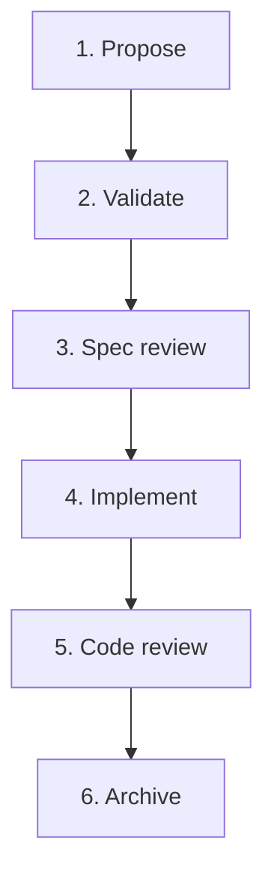

# Spec-Driven Development: sıfırdan praktik bələdçi

[English](README.md) · [Vizual versiya](https://aminqurbanov.github.io/sdd-guide/az.html)

Backend developerlər üçün Spec-Driven Development (SDD) haqqında qısa, praktik giriş: nədir, nə vaxt fayda verir, spec necə yazılır, komandada necə başlamaq olar. Nümunələr [OpenSpec](https://github.com/Fission-AI/OpenSpec) ilədir, amma fikirlər istənilən alətlə və ya sadə Markdown ilə işləyir.

Oxuma vaxtı: təxminən 15 dəqiqə.

---

## 1. Qısaca

- **SDD = əvvəl spec, sonra kod.** Kodu yazmazdan əvvəl qısa sənəd yazırsan: nə dəyişir, niyə dəyişir, sistem necə davranmalıdır.
- **Spec kod hələ yoxkən review olunur.** Təsdiqlənmiş spec implementasiyaya başlamaq üçün yaşıl işıqdır.
- **Kod spec-ə görə yazılır**, task-task. Kodu özün yazırsan, ya AI agent yazır, fərq etmir.
- **Code review kodu spec ilə yoxlayır**, reviewer-in niyyət haqqında təxmini ilə yox.
- **Release-dən sonra spec archive olunur** və servisin canlı sənədinə çevrilir: "sistem bu gün necə işləyir".
- **İstifadə et:** yeni servis, yeni endpoint və ya consumer, schema dəyişikliyi, servislərarası axın, AI-ın çox kod yazdığı dəyişiklik.
- **Lazım deyil:** bug fix, config dəyişikliyi, dependency yeniləmə, incident hotfix.

---

## 2. Niyə lazımdır?

Tanış hekayə:

1. Ticket gəlir. Kimsə (və ya agent) dərhal kod yazmağa başlayır.
2. 1500 sətirlik merge request gəlir. Reviewer niyyəti diff-dən geri çıxarmağa çalışır.
3. Əsl dizayn müzakirəsi ("bu niyə sinxrondur?") yalnız indi başlayır, istiqaməti dəyişmək artıq bahadır.
4. Altı ay sonra heç kim kodun niyə belə olduğunu xatırlamır. Cavab chat thread-də itib.

AI agentlər bunu daha da pisləşdirir: niyyəti prompt-dan təxmin edirlər və böyük, sərhədsiz dəyişikliklər yaradırlar.

| Spec-siz | Spec ilə |
|---|---|
| Dizayn kodun içində gizlidir | Dizayn 1-2 səhifəlik sənəddədir |
| Müzakirə böyük MR-da başlayır | Müzakirə qısa spec-də, koddan əvvəl başlayır |
| MR-ı rədd etmək günlər aparır | Spec-i rədd etmək bir saat aparır |
| "Niyə?" chat tarixçəsindədir | "Niyə?" repo-dadır |
| Agent prompt-dan təxmin edir | Agent razılaşdırılmış müqaviləyə əməl edir |

---

## 3. Spec nədir?

> **Spec** sistemin **necə davranmalı olduğunu** yoxlanıla bilən şəkildə təsvir edir. Kod spec-in implementasiyasıdır.

Spec kodu yox, **davranışı** təsvir edir.

- Spec deyil: "`OrderPublishService`-ə `if` əlavə et."
- Spec-dir: "Status `SENT` olan sorğu republish edilsə, sistem 409 qaytarmalıdır (SHALL)."

Yaxşı spec-in üç əlaməti:

1. **Normativ açar sözlər** ([RFC 2119](https://www.rfc-editor.org/rfc/rfc2119)): `SHALL` = məcburi, `SHOULD` = tövsiyə, `MAY` = istəyə bağlı.
2. **Hər tələbin ən azı bir ssenarisi var:** WHEN nəsə baş verir, THEN nəticə budur.
3. **Hər ssenari testə çevrilir.** Testə çevirə bilmirsənsə, yenidən yaz.

---

## 4. Nə vaxt istifadə etmək

Qanun yox, praktik qayda:

| Dəyişiklik | Spec? |
|---|---|
| Yeni servis və ya yeni capability | Bəli |
| Yeni endpoint, yeni consumer, schema dəyişikliyi, servislərarası axın | Bəli, ən uyğun hal budur |
| Kodun çoxunu AI agent yazır | Bəli |
| Davranışı dəyişməyən refactoring | İstəyə bağlı |
| Bug fix, config, dependency yeniləmə, bir sətirlik dəyişiklik | Xeyr |
| Prod incident hotfix | Heç vaxt. Hotfix-i sənədə görə saxlama |

**Əsas qayda:** spec lazım olan dəyişikliklərdə spec təsdiqlənməmiş implementasiyaya başlama. Kiçik dəyişikliklərdə spec və kod bir MR-da gedə bilər, şərtlə ki, spec commit-ləri əvvəl gəlsin.

Bir sətirlik dəyişiklik üçün spec yazırsansa, səhv edirsən. SDD dizayn vərdişidir, bürokratiya deyil.

---

## 5. SDD delivery prosesində harada durur

SDD məhsul prosesini əvəz etmir. Yalnız **developerin texniki işi necə planlaşdırdığını** dəyişir.

| Addım | Sahibi (dəyişmir) | SDD nəyi dəyişir |
|---|---|---|
| Story və biznes acceptance criteria | Product | Heç nəyi. Ticket biznes niyyətinin mənbəyi olaraq qalır |
| Development-ə hazırlıq | Komanda | Story spec-dən əvvəl hazır olmalıdır |
| Texniki dizayn və sub-task-lar | Developer | **SDD buradır.** Proposal, spec və task siyahısı dağınıq qeydləri əvəz edir |
| İmplementasiya | Developer | Təsdiqlənmiş spec üzrə, task-task |
| Code review | Developer + reviewer | MR spec-ə link verir. Reviewer kodu spec ilə yoxlayır |
| Release-dən sonra | Developer | Dəyişiklik archive olunur. Yeni ticket lazım deyil |

---

## 6. Repo-da nə olur

```
openspec/
├── project.md                  # servis qaydaları: stack, stil, testlər (bir dəfə yazılır)
├── specs/                      # CARİ davranış, hər capability üçün bir qovluq
│   └── <capability>/spec.md
└── changes/                    # TƏKLİF olunan davranış, hər açıq dəyişiklik üçün bir qovluq
    ├── <change-name>/
    │   ├── proposal.md         # niyə + nə, təxminən bir səhifə
    │   ├── tasks.md            # nömrələnmiş iş siyahısı
    │   ├── design.md           # istəyə bağlı: açıq-aydın olmayan qərarlar, rədd edilmiş variantlar
    │   └── specs/              # delta-lar: ADDED / MODIFIED / REMOVED
    └── archive/
        └── YYYY-MM-DD-<change-name>/
```

- `specs/` **bu gün doğru olandır**.
- `changes/` **dəyişməyi təklif etdiyimizdir**.
- Release-dən sonra delta-lar `specs/`-ə birləşir, change qovluğu `archive/`-ə köçür.

| Fayl | Məqsəd | Review fokusu |
|---|---|---|
| `project.md` | Hər insanın və agentin əməl etməli olduğu qaydalar | Bir dəfə, qurulanda |
| `proposal.md` | Niyə, nə dəyişir, nə **dəyişmir** | İmplementasiyadan əvvəl |
| `specs/` delta-ları | Tələblər + ssenarilər: yoxlanıla bilən müqavilə | **Əsas review hədəfi** |
| `design.md` | Açıq-aydın olmayan texniki qərarlar və alternativlər | Yalnız lazım olanda |
| `tasks.md` | Developerin və ya agentin icra etdiyi siyahı | Üstündən keç |

---

## 7. Spec yazmaq

### 7.1 Format

```markdown
## ADDED Requirements

### Requirement: Manual republish of a failed order event
The system SHALL allow a manual republish only when the request status is FAIL.

#### Scenario: Failed request is republished
- **WHEN** an operator calls `POST /v1/orders/{orderId}/republish` for a request in status FAIL
- **AND** the message broker acknowledges the event
- **THEN** the system responds 204
- **AND** the request status becomes SENT

#### Scenario: Request was already sent
- **WHEN** an operator calls republish for a request in status SENT
- **THEN** the system responds 409 with code REPUBLISH_NOT_ALLOWED
- **AND** no event is published

#### Scenario: Unknown request
- **WHEN** an operator calls republish for an unknown orderId
- **THEN** the system responds 404 with code REQUEST_NOT_FOUND
```

Spec-lər adətən ingiliscə yazılır, çünki alətlər və açar sözlər ingiliscədir.

### 7.2 Pis və yaxşı tələb

| Pis | Yaxşı | Niyə |
|---|---|---|
| "Xətalar düzgün emal olunmalıdır" | "Broker 30 saniyə ərzində təsdiq verməsə, sistem sorğunu FAIL kimi işarələməlidir (SHALL)" | "Düzgün" test olunmur |
| "`OrderEventHandler` sinfi yarat" | "Eyni orderId ilə təkrar event yeni sorğu yaratmamalıdır (SHALL NOT)" | Sinfi yox, davranışı yaz |
| Ssenarisiz tələb | Hər tələbə ən azı bir WHEN/THEN | Ssenari yoxdursa, test də yoxdur |
| Bir ssenaridə beş hal | Hər ssenaridə bir hal | Bir ssenari = bir test |

### 7.3 `proposal.md` şablonu

```markdown
# Proposal: <qısa başlıq>

Ticket: <KEY>. Dizayn qeydləri: <link, varsa>.

## Why
<problem və niyə indi, 3-5 cümlə>

## What Changes
- <davranış dəyişikliyi 1>
- <davranış dəyişikliyi 2>
- <nə DƏYİŞMİR - açıq yaz>

## Capabilities
### New
- `<capability>`: <bir cümlə>
### Modified
- `<capability>`: <nə dəyişir>

## Impact
- <təsirlənən servislər, config, DB, contract-lar>
- <risklər və müvəqqəti həllər>
```

### 7.4 `design.md`: yalnız açıq-aydın olmayan qərarlar üçün

Hər qərar üçün bir qısa blok:

> **Qərar:** nəyi seçdik. **Niyə:** səbəb. **Alternativlər:** nəyi rədd etdik və niyə.

Nümunə:

> **Qərar:** sinxron göndər və broker təsdiqini timeout ilə gözlə. **Niyə:** sorğunun statusu (SENT və ya FAIL) təsdiqdən asılıdır. **Alternativ:** callback ilə fire-and-forget. Rədd edildi, çünki uğursuz göndərişi eyni axında etibarlı qeyd etmək olmurdu.

Bir il sonra kimsə "bu niyə sinxrondur?" deyə soruşanda cavab buradadır.

---

## 8. Bir dəyişikliyin həyat dövrü



1. **Propose.** `openspec/changes/<change-name>/` yarat: proposal, spec delta-ları, tasks. Ticket-ə link ver.
2. **Validate.** `openspec validate <change-name> --strict` işlət. Review istəməzdən əvvəl bütün xətaları düzəlt.
3. **Spec review.** **Yalnız** change qovluğu olan, kodsuz MR aç. Approve "get, yaz" deməkdir.
4. **Implement.** `tasks.md` üzrə işlə və task-ları işarələ. Yeni scope çıxsa, **əvvəl spec-i yenilə**, yenidən validate et, sonra kod yaz. Spec heç vaxt koddan geri qalmır.
5. **Code review.** Change qovluğuna link verən adi MR. Reviewer kodu təsdiqlənmiş ssenarilərlə yoxlayır.
6. **Archive.** `openspec archive <change-name>` işlət. Delta-lar `specs/`-ə birləşir. Adətən bu, elə kod MR-ında edilir.

**Tracker məsləhəti:** spec MR-da `Refs <KEY>`, `Closes <KEY>` isə yalnız kod MR-da yaz. Yoxsa ticket kod yazılmamış bağlanar.

---

## 9. AI coding agentlərlə iş

- **Agent təsdiqlənmiş spec və `tasks.md` üzrə işləyir**, sərbəst prompt üzrə yox.
- **Hər artefaktın sahibi insandır.** Agentin yazdığı spec də eyni review-dan keçir. "Agent yazıb" cavab deyil: MR-ı açan müəllifdir.
- **Agentə `project.md` ver** (stack, paket strukturu, kod stili, test adlandırması, nə heç vaxt loglanmır) ki, kod servisin stilində olsun.
- **Səssiz kənarlaşma yoxdur.** Agent spec-dən çıxmalıdırsa, əvvəl spec dəyişir və yenidən review olunur.
- **AI review tapıntılarına ciddi yanaş.** Hər birini ya düzəlt, ya şüurlu trade-off kimi sənədləşdir, ya da ticket-ə köçür.
- **Modelə heç vaxt sirr vermə:** açar, credential, şəxsi data, prod data. Yalnız təşkilatının təsdiqlədiyi alətlərdən istifadə et.
- **AI ilə yazılmış commit-ləri işarələ**, məsələn `Co-Authored-By:` trailer-i ilə, ki komanda AI-ın harada kömək etdiyini görsün.
- **MR-ları review oluna bilən saxla.** Spec-i reviewer-in bir oturuşda oxuya biləcəyi hissələrə böl. Bölmək olmursa, səbəbini MR-da yaz.

Faydalı fənd, **idea grilling**: kobud ideyanı agentə ver və heç nə yazmazdan əvvəl səni sorğu-suala tutmasını istə. Ağlına gəlməyən suallar erkən çıxır, spec daha tez yetişir.

---

## 10. Beş əmrdə OpenSpec

```bash
npm install -g @fission-ai/openspec
```

| Tapşırıq | Əmr |
|---|---|
| Repo-nu qurmaq (bir dəfə) | `openspec init` |
| Açıq dəyişikliklərin siyahısı | `openspec list` |
| Dəyişikliyi yoxlamaq (review-dan əvvəl) | `openspec validate <change-name> --strict` |
| Dəyişikliyə və ya spec-ə baxmaq | `openspec show <change-name>` |
| Release-dən sonra archive | `openspec archive <change-name>` |

Alət versiyasını repo-da pin et ki, validasiya hamıda eyni nəticə versin. Versiyanın dəstəklədiyi flag-lar üçün `openspec --help` yoxla.

---

## 11. İşlənmiş nümunə: `tasks.md`

7.1-dəki republish tələbi üçün:

```markdown
## 1. API
- [ ] 1.1 Add `POST /v1/orders/{orderId}/republish` - verify with controller test for 204/404/409
- [ ] 1.2 Map REPUBLISH_NOT_ALLOWED and REQUEST_NOT_FOUND to error responses - verify with error-handler test

## 2. Logic
- [ ] 2.1 Allow republish only from status FAIL - verify with service test per status
- [ ] 2.2 Set status SENT on broker acknowledgement, FAIL on timeout - verify with broker stub test

## 3. Docs
- [ ] 3.1 Update the API description
```

Hər task **"verify with ..."** ilə bitir: onu sübut edən test. Bu bir vərdiş həm agentin işini, həm də review-u xeyli asanlaşdırır.

---

## 12. Checklist-lər

### Spec MR açmazdan əvvəl

- [ ] Story development-ə hazırdır
- [ ] `proposal.md` niyə, nə və nə **dəyişmədiyini** deyir, ticket-ə link verir
- [ ] Hər tələbdə `SHALL` / `SHOULD` / `MAY` var
- [ ] Hər tələbin ən azı bir WHEN/THEN ssenarisi var
- [ ] Hər ssenari testə çevrilə bilər
- [ ] Açıq-aydın olmayan qərarlar alternativləri ilə `design.md`-dədir
- [ ] `tasks.md`-də hər task-ın necə yoxlandığı yazılıb
- [ ] `openspec validate <name> --strict` keçir
- [ ] MR-da yalnız change qovluğu var (ilk dəfə, üstəlik `project.md`)
- [ ] MR-da `Refs <KEY>` yazılıb, `Closes` yox

### Kod MR açmazdan əvvəl

- [ ] Description change qovluğuna link verir
- [ ] `tasks.md`-də bütün task-lar işarələnib
- [ ] Kod spec-dən kənara çıxmır (və ya spec əvvəl yenilənib, yenidən review olunub)
- [ ] Hər ssenarinin testi var
- [ ] Hər AI review tapıntısı düzəldilib, sənədləşdirilib və ya ticket-ə köçürülüb
- [ ] AI ilə yazılmış commit-lər işarələnib
- [ ] Validasiya yenə keçir
- [ ] Dəyişiklik archive edilib və ya follow-up planlaşdırılıb
- [ ] MR-da `Closes <KEY>` yazılıb

---

## 13. Tez-tez edilən səhvlər

| Səhv | Nə olur | Əvəzinə |
|---|---|---|
| Spec-i koddan sonra yazmaq | Spec formal sənədə çevrilir, review heç nə vermir | Əvvəl spec |
| Spec-də sinif və metod adları | Bu kod planıdır, spec deyil | Davranışı yaz. İmplementasiya qeydləri `design.md` və ya `tasks.md`-yə |
| "Düzgün", "tez", "rahat" kimi sözlər | Test olunmur | Konkret dəyər: status, kod, müddət |
| Kodu dəyişib spec-i yeniləməmək | Səssiz kənarlaşma, sənəd yalan danışır | Əvvəl spec, sonra kod |
| Spec MR-da `Closes` | Ticket kodsuz bağlanır | Spec MR-da `Refs`, kod MR-da `Closes` |
| Bir sətir üçün spec | Bürokratiya | 4-cü bölməyə bax |
| Hotfix-i spec-ə görə saxlamaq | Prod zərər çəkir | Hotfix heç vaxt gözləmir |
| Archive etməyi unutmaq | `specs/` köhnəlir | Kod MR-da archive et |

---

## 14. FAQ

**Spec review ikinci code review deyilmi?**
Xeyr. Backlog refinement biznes scope-unu həll edir. Spec review texniki dizaynın fokuslu müzakirə olunduğu yerdir, bir səhifəlik spec isə böyük diff-dən daha diqqətlə oxunur. Kiçik dəyişikliklərdə spec və kod bir MR-da gedir, review sayı artmır.

**Spec ticket-i əvəz edirmi?**
Xeyr. Biznes niyyəti və acceptance criteria ticket-də qalır. Spec texniki davranış müqaviləsidir.

**Sub-task açmağa davam edək?**
İstəsəniz. `tasks.md` texniki bölgüdür. Nə qədərini tracker-ə köçürmək komandanın seçimidir.

**OpenSpec məcburidirmi?**
Xeyr. Praktika vacibdir, alət yox. Artefaktları, review addımını və archive-ı saxlayırsansa, istənilən alət və ya sadə Markdown işləyir.

**AI agent spec-i yaza bilərmi?**
Bəli. Amma insan yenə review edir və ona sahiblik edir.

**Mövcud servisin hamısını spec-ə köçürməliyik?**
Xeyr. Spec yalnız yeni dəyişikliklər üçün yazılır. `specs/` dəyişikliklər archive olunduqca tədricən dolur.

---

## 15. İstinadlar

- [OpenSpec](https://github.com/Fission-AI/OpenSpec) (npm-də `@fission-ai/openspec`)
- [RFC 2119](https://www.rfc-editor.org/rfc/rfc2119): SHALL, SHOULD, MAY-ın mənası
- [Architecture Decision Records](https://adr.github.io/)

---

## Lisenziya

[CC BY 4.0](LICENSE). Müəllifi göstərməklə sərbəst paylaşa və dəyişə bilərsən.
