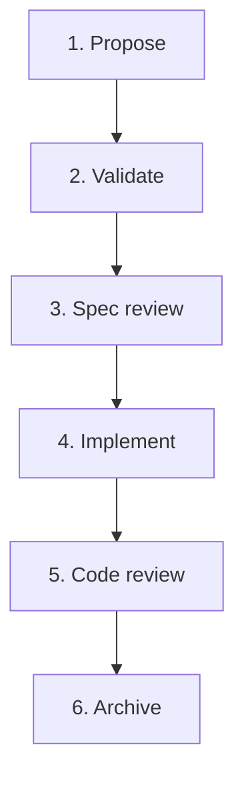

# Spec-Driven Development: a practical guide from zero

[Azərbaycanca](README.az.md) · [Visual version](https://aminqurbanov.github.io/sdd-guide/)

A short, practical introduction to Spec-Driven Development (SDD) for backend developers: what it is, when it pays off, how to write a spec, and how to start in a team. Examples use [OpenSpec](https://github.com/Fission-AI/OpenSpec), but the ideas work with any tool or plain Markdown.

Reading time: about 15 minutes.

---

## 1. TL;DR

- **SDD = spec first, code second.** Before coding, write a short document: what changes, why, and how the system must behave.
- **The spec is reviewed before the code exists.** An approved spec is the green light to start implementing.
- **Code follows the spec**, task by task, whether you write it or an AI agent does.
- **Code review checks the code against the spec**, not just against the reviewer's guess of the intent.
- **After release, the spec is archived** into the service's living documentation: "how the system works today".
- **Use it** for new services, new endpoints or consumers, schema changes, cross-service flows, and AI-heavy changes.
- **Skip it** for bug fixes, config changes, dependency bumps, and incident hotfixes.

---

## 2. Why bother?

The familiar story:

1. A ticket arrives. Someone (or some agent) starts coding right away.
2. A 1,500-line merge request lands. The reviewer reverse-engineers the intent from the diff.
3. The real design debate ("why is this synchronous?") starts only now, when changing course is expensive.
4. Six months later nobody remembers why the code looks like this. The answer is lost in a chat thread.

AI coding agents make this worse: they guess intent from a prompt and produce large, unbounded changes.

| Without a spec | With a spec |
|---|---|
| Design is hidden inside the code | Design is a 1-2 page document |
| Debate starts in a huge MR | Debate starts in a short spec, before code |
| Rejecting an MR costs days | Rejecting a spec costs an hour |
| "Why?" lives in chat history | "Why?" lives in the repo |
| The agent guesses from a prompt | The agent follows an agreed contract |

---

## 3. What is a spec?

> A **spec** describes how the system **must behave**, in a way you can verify. The code is an implementation of the spec.

A spec describes **behavior**, not code.

- Not a spec: "Add an `if` to `OrderPublishService`."
- A spec: "When a request in status `SENT` is republished, the system SHALL respond 409."

Three marks of a good spec:

1. **Normative keywords** ([RFC 2119](https://www.rfc-editor.org/rfc/rfc2119)): `SHALL` = must, `SHOULD` = recommended, `MAY` = optional.
2. **Every requirement has at least one scenario**: WHEN something happens, THEN this is the result.
3. **Every scenario becomes a test.** If you cannot turn it into a test, rewrite it.

---

## 4. When to use it

A rule of thumb, not a law:

| Change | Spec? |
|---|---|
| New service or new capability | Yes |
| New endpoint, new consumer, schema change, cross-service flow | Yes, this is the sweet spot |
| An AI agent writes most of the code | Yes |
| Refactoring with no behavior change | Optional |
| Bug fix, config, dependency bump, one-liner | No |
| Production incident hotfix | Never. Do not block a hotfix on paperwork |

**The one rule that matters:** for changes that need a spec, do not start implementing until the spec is approved. For small changes, the spec and code can share one MR, as long as the spec commits come first.

If you are writing a spec for a one-line change, you are doing it wrong. SDD is a design habit, not bureaucracy.

---

## 5. Where SDD fits in delivery

SDD does not replace your product process. It changes only **how the developer plans the technical work**.

| Step | Owner (unchanged) | What SDD changes |
|---|---|---|
| Story and business acceptance criteria | Product | Nothing. The ticket remains the source of business intent |
| Ready for development | Team | The story is ready before a spec starts |
| Technical design and sub-tasks | Developer | **This is SDD.** Proposal, spec, and task list replace scattered notes |
| Implementation | Developer | Follows the approved spec, task by task |
| Code review | Developer + reviewer | The MR links the spec. The reviewer checks the code against it |
| After release | Developer | The change is archived. No new ticket needed |

---

## 6. What lives in the repo

```
openspec/
├── project.md                  # service conventions: stack, style, tests (written once)
├── specs/                      # CURRENT behavior, one folder per capability
│   └── <capability>/spec.md
└── changes/                    # PROPOSED behavior, one folder per open change
    ├── <change-name>/
    │   ├── proposal.md         # why + what, about one page
    │   ├── tasks.md            # numbered work list
    │   ├── design.md           # optional: non-obvious decisions, rejected options
    │   └── specs/              # deltas: ADDED / MODIFIED / REMOVED
    └── archive/
        └── YYYY-MM-DD-<change-name>/
```

- `specs/` is **what is true today**.
- `changes/` is **what we propose to change**.
- After release, the deltas merge into `specs/`, and the change folder moves to `archive/`.

| File | Purpose | Review focus |
|---|---|---|
| `project.md` | Conventions every human and agent must follow | Once, at setup |
| `proposal.md` | Why, what changes, what does **not** change | Before implementation |
| `specs/` deltas | Requirements + scenarios: the testable contract | **The main review target** |
| `design.md` | Non-obvious technical decisions and alternatives | Only when needed |
| `tasks.md` | Checklist the developer or agent works through | Skim |

---

## 7. Writing a spec

### 7.1 Format

```markdown
## ADDED Requirements

### Requirement: Manual republish of a failed order event
The system SHALL allow a manual republish only when the request status is FAIL.

#### Scenario: Failed request is republished
- **WHEN** an operator calls `POST /v1/orders/{orderId}/republish` for a request in status FAIL
- **AND** the message broker acknowledges the event
- **THEN** the system responds 204
- **AND** the request status becomes SENT

#### Scenario: Request was already sent
- **WHEN** an operator calls republish for a request in status SENT
- **THEN** the system responds 409 with code REPUBLISH_NOT_ALLOWED
- **AND** no event is published

#### Scenario: Unknown request
- **WHEN** an operator calls republish for an unknown orderId
- **THEN** the system responds 404 with code REQUEST_NOT_FOUND
```

### 7.2 Bad vs good requirements

| Bad | Good | Why |
|---|---|---|
| "Errors must be handled properly" | "If the broker does not acknowledge within 30 seconds, the system SHALL mark the request FAIL" | "Properly" cannot be tested |
| "Create an `OrderEventHandler` class" | "A duplicate event with the same orderId SHALL NOT create a new request" | Describe behavior, not classes |
| A requirement with no scenario | At least one WHEN/THEN per requirement | No scenario, no test |
| Five cases in one scenario | One case per scenario | One scenario = one test |

### 7.3 `proposal.md` template

```markdown
# Proposal: <short title>

Ticket: <KEY>. Design notes: <link, if any>.

## Why
<the problem and why now, 3-5 sentences>

## What Changes
- <behavior change 1>
- <behavior change 2>
- <what does NOT change - say it explicitly>

## Capabilities
### New
- `<capability>`: <one sentence>
### Modified
- `<capability>`: <what changes>

## Impact
- <services, config, database, contracts affected>
- <risks and temporary workarounds>
```

### 7.4 `design.md`: only for non-obvious decisions

Use one short block per decision:

> **Decision:** what we chose. **Why:** the reason. **Alternatives:** what we rejected and why.

Example:

> **Decision:** publish synchronously and wait for the broker acknowledgement, with a timeout. **Why:** the request status (SENT or FAIL) depends on the acknowledgement. **Alternative:** fire-and-forget with a callback. Rejected, because a failed send could not be recorded reliably in the same flow.

When someone asks "why is this synchronous?" a year later, the answer is here.

---

## 8. The lifecycle of one change



1. **Propose.** Create `openspec/changes/<change-name>/` with a proposal, spec deltas, and tasks. Link the ticket.
2. **Validate.** Run `openspec validate <change-name> --strict`. Fix every error before asking for review.
3. **Spec review.** Open an MR that contains **only** the change folder, with no code. Approval means "go build it".
4. **Implement.** Work through `tasks.md` and tick tasks off. If new scope appears, **update the spec first**, re-validate, then code. The spec never falls behind the code.
5. **Code review.** A normal MR that links the change folder. The reviewer checks the code against the approved scenarios.
6. **Archive.** Run `openspec archive <change-name>`. The deltas merge into `specs/`. Usually this happens in the code MR itself.

**Tracker tip:** write `Refs <KEY>` in the spec MR and `Closes <KEY>` only in the code MR. Otherwise the ticket closes before any code exists.

---

## 9. Working with AI coding agents

- **The agent works from the approved spec and `tasks.md`**, not from a free-form prompt.
- **A human owns every artifact.** Specs written by an agent get the same review. "The agent wrote it" is never an answer: whoever opens the MR is the author.
- **Give the agent `project.md`** (stack, package layout, code style, test naming, what must never be logged), so the code matches the service.
- **No silent drift.** If the agent needs to leave the spec, change the spec first and get it reviewed again.
- **Treat AI review findings seriously.** For each finding, either fix it, document it as a deliberate trade-off, or move it to a ticket.
- **Never paste secrets** (keys, credentials, personal data, production data) into a model. Use only tools your organization has approved.
- **Mark AI-assisted commits**, for example with a `Co-Authored-By:` trailer, so the team can see where AI helped.
- **Keep MRs reviewable.** Split the spec into pieces a reviewer can read in one sitting. If you cannot split it, explain why in the MR.

Useful trick, **idea grilling**: give the agent your rough idea and ask it to question you before writing anything. Questions you never thought of surface early, and the spec matures faster.

---

## 10. OpenSpec in five commands

```bash
npm install -g @fission-ai/openspec
```

| Task | Command |
|---|---|
| Set up a repo (once) | `openspec init` |
| List open changes | `openspec list` |
| Validate a change (before review) | `openspec validate <change-name> --strict` |
| Show a change or spec | `openspec show <change-name>` |
| Archive after release | `openspec archive <change-name>` |

Pin the tool version in the repo, so validation gives everyone the same result. Check `openspec --help` for the flags your version supports.

---

## 11. Worked example: `tasks.md`

For the republish requirement from section 7.1:

```markdown
## 1. API
- [ ] 1.1 Add `POST /v1/orders/{orderId}/republish` - verify with controller test for 204/404/409
- [ ] 1.2 Map REPUBLISH_NOT_ALLOWED and REQUEST_NOT_FOUND to error responses - verify with error-handler test

## 2. Logic
- [ ] 2.1 Allow republish only from status FAIL - verify with service test per status
- [ ] 2.2 Set status SENT on broker acknowledgement, FAIL on timeout - verify with broker stub test

## 3. Docs
- [ ] 3.1 Update the API description
```

Every task ends with **"verify with ..."**: the test that proves it. This one habit makes both the agent's work and the review much easier.

---

## 12. Checklists

### Before you open a spec MR

- [ ] The story is ready for development
- [ ] `proposal.md` says why, what, and what does **not** change, and links the ticket
- [ ] Every requirement uses `SHALL` / `SHOULD` / `MAY`
- [ ] Every requirement has at least one WHEN/THEN scenario
- [ ] Every scenario can become a test
- [ ] Non-obvious decisions are in `design.md`, with alternatives
- [ ] Every task in `tasks.md` says how it is verified
- [ ] `openspec validate <name> --strict` passes
- [ ] The MR contains only the change folder (plus `project.md` the first time)
- [ ] The MR says `Refs <KEY>`, not `Closes`

### Before you open a code MR

- [ ] The description links the change folder
- [ ] All tasks in `tasks.md` are ticked
- [ ] The code does not go beyond the spec (or the spec was updated and re-reviewed first)
- [ ] Every scenario has a test
- [ ] Every AI review finding is fixed, documented, or ticketed
- [ ] AI-assisted commits are marked
- [ ] Validation still passes
- [ ] The change is archived, or a follow-up is planned
- [ ] The MR says `Closes <KEY>`

---

## 13. Common mistakes

| Mistake | What happens | Instead |
|---|---|---|
| Writing the spec after the code | The spec becomes paperwork, review adds nothing | Spec first |
| Class and method names in the spec | It is a code plan, not a spec | Describe behavior. Put implementation notes in `design.md` or `tasks.md` |
| Words like "properly", "fast", "user-friendly" | Untestable | Use concrete values: status, code, duration |
| Changing code without updating the spec | Silent drift, the docs lie | Spec first, then code |
| `Closes` in the spec MR | The ticket closes with no code | `Refs` in the spec MR, `Closes` in the code MR |
| A spec for a one-liner | Bureaucracy | See section 4 |
| Blocking a hotfix on a spec | Production suffers | Hotfixes never wait |
| Forgetting to archive | `specs/` goes stale | Archive in the code MR |

---

## 14. FAQ

**Isn't spec review just a second code review?**
No. Backlog refinement settles business scope. Spec review is where the technical design gets a focused discussion, and a one-page spec is read far more carefully than a large diff. For small changes, spec and code share one MR, so the number of reviews does not grow.

**Does the spec replace the ticket?**
No. Business intent and acceptance criteria stay in the ticket. The spec is the technical behavior contract.

**Should we keep creating sub-tasks?**
If you like. `tasks.md` is the technical breakdown. How much of it you copy into the tracker is up to the team.

**Is OpenSpec required?**
No. The practice matters, the tool does not. Any tool, or plain Markdown, works if you keep the artifacts, the review step, and the archive.

**Can an AI agent write the spec?**
Yes. A human still reviews it and owns it.

**Do we have to spec the whole existing service?**
No. Write specs only for new changes. `specs/` fills up gradually as changes are archived.

---

## 15. References

- [OpenSpec](https://github.com/Fission-AI/OpenSpec) (`@fission-ai/openspec` on npm)
- [RFC 2119](https://www.rfc-editor.org/rfc/rfc2119): meaning of SHALL, SHOULD, MAY
- [Architecture Decision Records](https://adr.github.io/)

---

## License

[CC BY 4.0](LICENSE). Share and adapt freely, with attribution.
